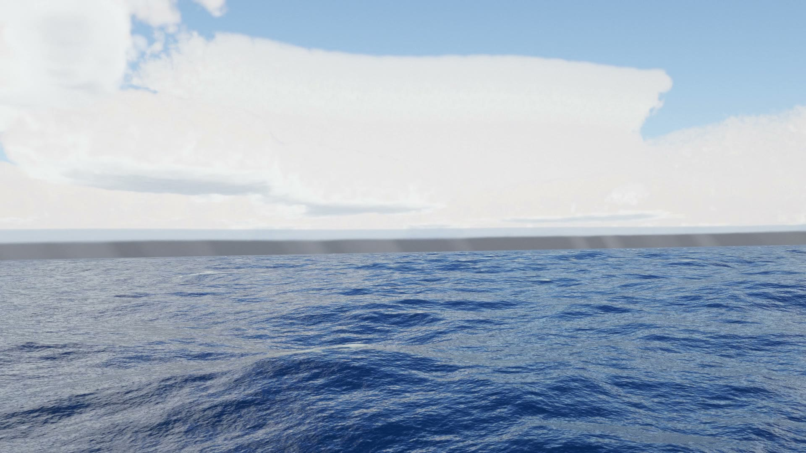
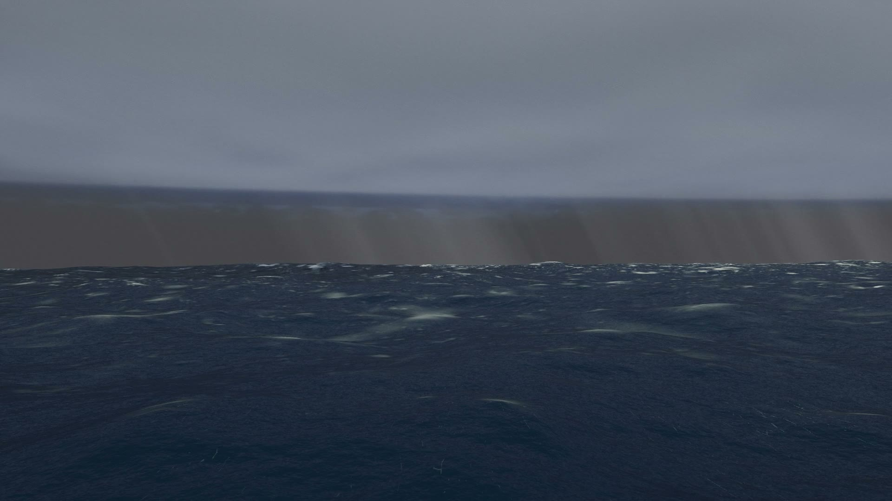
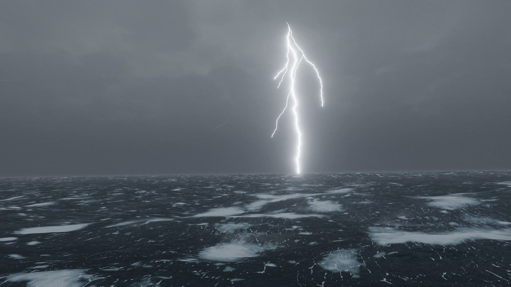
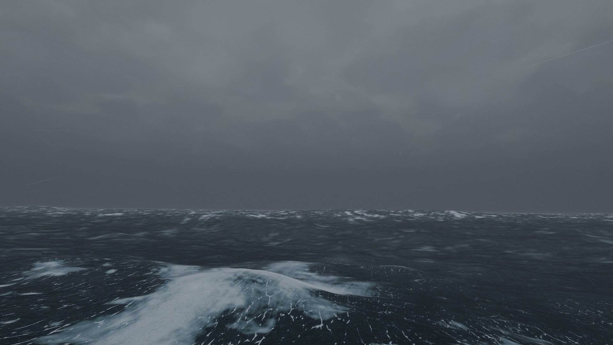
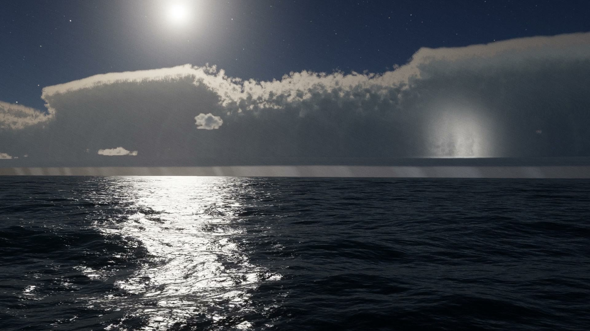
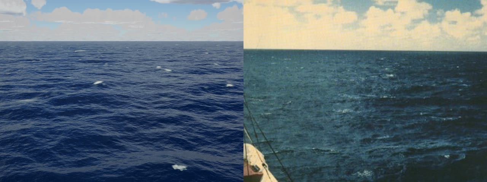
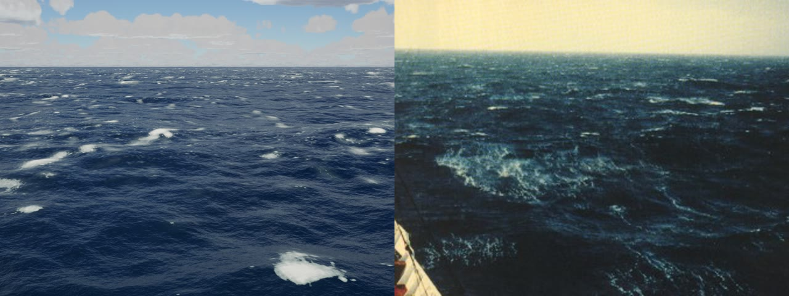
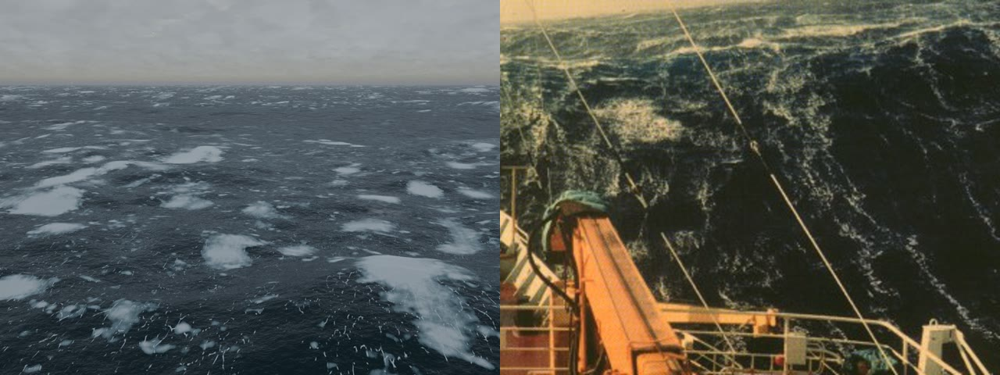

# Open Water

A real-time, physically based ocean in pure WebGL2, with weather you can steer: calm golden
hours, rising wind, rain, squall lines, gales, lightning and moonlit nights. There are no textures, models or
image assets. Every wave, cloud, foam bubble and raindrop is computed. The only recorded
material is sound (rain and thunder).

| | |
| --- | --- |
|  |  |
|  |  |
|  |  |

**Live:** https://leonxlnx.github.io/open-water/ · **Film:** [`media/open-water.mp4`](media/open-water.mp4) (one minute, 1080p60, rendered offline by the same engine; the full-quality master is on the [releases page](https://github.com/Leonxlnx/open-water/releases)).

The film runs in three acts: a golden-hour calm; a squall line of cumulonimbus crossing the sea,
with its shelf cloud, rain curtains, gale and lightning; and a moonlit night after the storm, with
the cell still flickering on the horizon.

## What is simulated

**Waves.** Tessendorf FFT synthesis on the GPU with four cascades (640 m down to 3.7 m) and
capillary-gravity dispersion. The wind sea uses the Elfouhaily et al. (1997) unified spectrum,
whose short-wave regime is calibrated to Cox–Munk slope statistics. Spreading is Donelan–Banner
near the peak and ECKV for short waves, plus a narrow-band swell. Choppy displacement gives
trochoidal crests. Significant wave heights match the Beaufort table (Bf 5: 2.1 m, Bf 7: 4.8 m,
Bf 9: 9.2 m), and the GPU statistics are checked against the spectrum (`tools/hscheck.mjs`).

**Light on water.** A slope-variance (LEAN) BRDF after Bruneton, Neyret and Holzschuch (2010)
makes geometry, normals and BRDF hand over seamlessly. Sub-cascade roughness is the Cox–Munk
remainder, so sun glitter breaks into sparkles up close and becomes a smooth path towards the
horizon. Also modeled: averaged Fresnel, water-leaving radiance from ocean-optics remote-sensing
reflectance (deep ultramarine that turns grey-green as breaking waves fill the water with
bubbles), backlit crest scattering, cloud shadows drifting over the sea, Earth curvature and
aerial perspective.

**Foam.** Whitecaps form where the surface Jacobian folds. The breaking threshold is expressed
in standard deviations of the Jacobian and calibrated so coverage follows the Monahan &
O'Muircheartaigh (1980) whitecap law (`tools/foam.mjs`). Foam decays into marbled lace, and at
gale force it is drawn into streaks along the wind.

**Sky.** The atmosphere follows Hillaire (2020): transmittance, multiple-scattering, sky-view
and aerial-perspective LUTs. Clouds are volumetric, built from procedural Perlin–Worley noise
with Beer–powder lighting, Wrenninge multiple-scattering octaves and two-stream diffusion
through thick storm decks. Light diffused through a deck takes the neutral-cool colour of
sun plus skylight.

A squall line moves the weather across the sea along a meandering front. It is a row of
cumulonimbus cells about 10 km tall whose anvil overhangs ahead of the line. A tiered shelf
cloud rides the gust front, with scud racing beneath it. The rain curtains carry shafts and fade
into the cloud base. Crepuscular rays are traced through the haze using the cloud-shadow map.
Spindrift is torn off breaking crests at gale force, and spray haze hugs the sea.

**Rain and storm.** Drop sizes follow Marshall–Palmer, with terminal velocities from Atlas et
al. (1973). Streak photometry follows Garg & Nayar: a drop covers its streak only D/(v·T) of
the exposure. Ring waves expand at the capillary minimum speed, and splash jets rise where drops
land. Rain curtains have shafts, and visibility falls with rain rate. Lightning has multiple
return strokes, a fractal branched channel and in-cloud illumination. It lights the scene with
I/d² (about 100 lux at 1 km) relative to sun- or moonlight, so a daytime strike barely brightens
the sea, while at night it outshines the moon. The channel is hidden inside the cloud and dimmed
by the rain between it and the viewer. Thunder arrives at 343 m/s and loses its high frequencies
with distance.

**Night.** The full moon takes over as the light source after civil twilight. This gives a
moon glitter path, moonlit clouds and a halo in the haze. Stars are point sources with physical
flux: the magnitude distribution N(<m) ∝ 10^(0.5m), colour temperatures, extinction, and
scintillation near the horizon. They show only once the sky is dark enough. A scotopic
(Purkinje) shift drains colour and tints the low light blue.

**Camera and image.** The camera floats on the sea, heaving, pitching and rolling with waves
longer than a small boat. Exposure meters the incident light, but meters the bright sky when
shooting into a low sun, as a photographer would, and storms are exposed dark. White balance is
fixed near daylight, so golden hour stays gold and storms stay steel-blue. AgX tone mapping is
followed by a photographic S-curve, plus an energy-conserving bloom and film grain.

**Sound.** Sea wash, whitecap hiss and gusting wind are synthesized from the same weather state.
Rain and thunder are recordings. The film's soundtrack is rendered by the same engine in an
`OfflineAudioContext`.

## How it was checked

Every visual decision was compared against real photographs, side by side (`tools/compare.mjs`).
The references were the NOAA Beaufort-scale series, open-ocean, overcast, rain-squall and storm
photography. The measurable parts are checked with tools:

| Quantity | Target | Result |
| --- | --- | --- |
| Significant wave height, Bf 5 / 7 / 9 (`tools/hscheck.mjs`) | 2–2.5 / 4–5.5 / 7–10 m | 2.1 / 4.8 / 9.2 m |
| GPU height variance vs. spectrum integral | equal | within sampling error (±10%) |
| Whitecap coverage at 8.5 / 15 / 21 m/s (`tools/foam.mjs`) | ~1.5–2× Monahan (visible residual foam included) | 0.8 / 6.5 / 19.7 % |
| Thunder delay | distance / 343 m/s | exact |
| Visibility in the heaviest rain (Koschmieder, 3.9 / β) | ~2–3 km | 3.0 km |
| Tonal range vs. reference photos (`tools/tonestats.mjs`) | p10 ≈ 5–45, highlights ≈ 230–255 | shadows deepened, highlights reach white |
| Lightning illuminance at 1 km (daytime) | ~100 lux on ~2000 lux storm light | +5% |

Side by side with NOAA's Beaufort-scale photographs. The render is on the left, seen from a ship's
deck 14 m up. The photos are from the NOAA Photo Library (public domain) and carry their film
stock's colour cast. At force 9 the real sea is darker, with denser foam lace than the render
produces so far.

| Force 5 (8.5 m/s) | Force 7 (15 m/s) | Force 9 (21 m/s) |
| --- | --- | --- |
|  |  |  |

A multi-agent review compared 13 scenes with real photographs and had independent judges confirm
each discrepancy. A second adversarial code review then confirmed 30 bugs, every one fixed.
Problems found and fixed this way included:
- Sun glitter rendered as a milky sheet instead of sparkles.
- Whitecaps missing at Bf 5.
- Overcast decks without texture (a flat base and too little thickness variation).
- A brown cast from sunlit haze under a storm deck.
- Hairline crest artifacts from mirrored downward reflections.
- Foam outlines with polygonal edges from thresholding a bilinear field.
- Waves travelling against the wind (sign of the time evolution).
- A NaN sea below 2.2 m/s wind (negative Elfouhaily short-wave coefficient).
- A veiled, compressed tonal range (highlights never above ~190/255).
- Whitecaps unrelated to the dominant crests.
- A seam in the sky reflection.
- Lightning washing the whole frame out in daylight.

## Controls

| | |
| --- | --- |
| Drag | look around |
| Scroll | rise or sink (below ~12 m the camera rides the waves) |
| `1`–`4` | Calm · Breeze · Rain · Storm |
| `T` | tuning sheet: wind, waves, chop, rain, clouds, lightning, sun |
| `L` | lightning strike |
| `N` | moonlit night (and back) |
| `M` | sound |
| `H` | hide the interface |
| `F` | fullscreen |

URL parameters: `?preset=storm`, any weather key (for example `?wind=14&rain=0.4`), `elev` and
`az` for the sun, `h` for eye height, and `q=high` for film quality.

## Run

```bash
npm run dev
```

Then open http://localhost:5173. No build step and no runtime dependencies. You need a browser
with WebGL2 and `EXT_color_buffer_float`, which covers every current desktop browser. The
default quality tier targets integrated GPUs; add `?q=high` for the film settings.

## Render the film

```bash
npm install
npm run dev
npm run render -- --fps 60 --w 1920 --h 1080 --out out/open-water.mp4
```

The renderer drives headless Chrome deterministically, frame by frame. Frames are piped into
ffmpeg/x264 and the soundtrack is muxed in. The timeline is in `src/film.js`.

## Layout

```
src/ocean/   FFT cascades, spectrum, foam, surface shading, surface probe
src/sky/     atmosphere LUTs, volumetric clouds, sky and reflection probe
src/fx/      rain, ripples, spindrift, lightning, post-processing
src/audio/   sound engine (live and offline)
src/film.js  the film timeline
tools/       dev server, screenshots, calibration (wave heights, foam coverage), profiling
render/      offline film renderer
```

## References

- J. Tessendorf, *Simulating Ocean Water*, SIGGRAPH course notes, 2001.
- T. Elfouhaily, B. Chapron, K. Katsaros, D. Vandemark, *A unified directional spectrum for long
  and short wind-driven waves*, JGR 102(C7), 1997.
- M. Donelan, J. Hamilton, W. Hui, *Directional spectra of wind-generated waves*, 1985.
- E. Bruneton, F. Neyret, N. Holzschuch, *Real-time Realistic Ocean Lighting using Seamless
  Transitions from Geometry to BRDF*, Computer Graphics Forum, 2010.
- C. Cox, W. Munk, *Measurement of the Roughness of the Sea Surface from Photographs of the
  Sun's Glitter*, JOSA, 1954.
- E. Monahan, I. O'Muircheartaigh, *Optimal power-law description of oceanic whitecap coverage
  dependence on wind speed*, JPO, 1980.
- S. Hillaire, *A Scalable and Production Ready Sky and Atmosphere Rendering Technique*, EGSR 2020.
- A. Schneider, *The Real-time Volumetric Cloudscapes of Horizon Zero Dawn*, SIGGRAPH 2015.
- M. Wrenninge et al., *Oz: The Great and Volumetric*, SIGGRAPH 2013 talk.
- K. Garg, S. Nayar, *Photorealistic Rendering of Rain Streaks*, SIGGRAPH 2006.
- J. Marshall, W. Palmer, *The distribution of raindrops with size*, 1948.
- T. Sobotka, AgX display transform.

## License

The code is MIT licensed. The audio recordings keep their Creative Commons licenses; see
[assets/audio/CREDITS.md](assets/audio/CREDITS.md).
